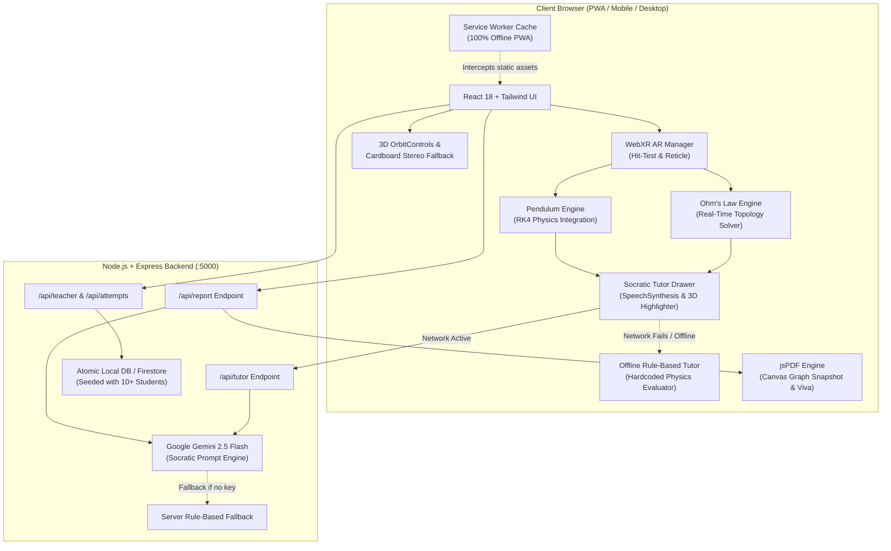

# AR Physics Lab by HackHounds

> **A low-cost, AI-powered AR/VR virtual physics laboratory that runs in mobile browsers on budget Android smartphones (~₹10k / $120) and laptops in plain 3D mode.**

Students perform physics experiments in AR/3D, make mistakes safely, and get an AI tutor that reads the live experiment state, explains what went wrong, and auto-generates an academic lab report. Teachers monitor class-wide scores, error distributions, and at-risk students in an interactive dashboard. Works 100% offline after the first visit.

---

## 📸 Screenshots & UI Showcase

```
+------------------------------------------------------------------------+
|  [Ψ AR Physics Lab]   [⚡ Ohm's Law] [⏱️ Pendulum]       [Enter AR] [EN] |
+------------------------------------------------------------------------+
|                                                                        |
|    [ 3D Lab Workbench / AR Camera Feed ]                               |
|                                                                        |
|    +-------------------+                     +--------------------+    |
|    | DC Power Supply   |                     | Analog Ammeter     |    |
|    | [==== 6.0 V ====] |                     | Needle Deflection  |    |
|    +-------------------+                     +--------------------+    |
|            |                                           |               |
|            +=========== [Ceramic Resistor] ============+               |
|                                                                        |
|   +-----------------------+              +-------------------------+   |
|   | Apparatus Controls    |              | 🤖 AI Socratic Tutor    |   |
|   | • Voltage Slider      |              | "Notice where ammeter   |   |
|   | • Resistor (10Ω)      |              |  is connected in line!" |   |
|   | • [✕ Ammeter Parallel]|              | [Nudge] [Explain] [Fix] |   |
|   | [Record Point (5/5)]  |              | 🔊 Voice [EN / हिन्दी]   |   |
|   +-----------------------+              +-------------------------+   |
+------------------------------------------------------------------------+
```

---

## 🏗️ Architecture Diagram



---

## ⚡ Key Highlights & Features

### 1. WebXR AR with Budget Phone Optimization (~₹10k)
- **Zero Heavy Assets (<2MB Total):** Procedural Three.js geometries and shaders replace bulky 40MB GLTF meshes, allowing budget smartphones to maintain 30-60 FPS without overheating or memory crashes.
- **Surface Hit-Test Placement:** Move your phone over any horizontal desk or floor, observe the glowing cyan reticle snap to the plane, and tap once to anchor your lab table.
- **Laptop & Desktop Fallback:** Automatically degrades to 3D OrbitControls if WebXR is unavailable. Includes a Google Cardboard VR split-screen stereo toggle.

### 2. Experiment A: Ohm's Law Circuit
- **Interactive Workbench:** DC Power Supply (1.5V to 12V), Ceramic Resistor (5Ω, 10Ω, 20Ω, 50Ω, 100Ω), Knife Switch, Analog Voltmeter (0-15V), and Ammeter (0-3A).
- **Detectable Student Mistakes:**
  1. `Ammeter in Parallel`: Near-zero internal resistance draws a dangerous short-circuit current spike.
  2. `Voltmeter in Series`: Massive 10MΩ internal resistance blocks circuit current ($I \approx 0$).
  3. `Direct Short Circuit`: Battery positive directly connected to negative without load (triggers smoke particles & sparks).
  4. `Reverse Polarity`: Current enters negative terminal, deflecting needle backward.
  5. `Resistor Overheating`: Supplying excessive power ($P = I^2 R > 2\text{W}$) triggers thermal glow and smoke.
  6. `Open Circuit`: Open knife switch or disconnected terminal.
- **V-I Graph Plotting:** Records 5 experimental points and calculates best-fit linear slope $R = \Delta V / \Delta I$.

### 3. Experiment B: Simple Pendulum
- **Physics Simulation:** Solves $\frac{d^2\theta}{dt^2} + \frac{b}{m}\frac{d\theta}{dt} + \frac{g}{L}\sin\theta = 0$ using Runge-Kutta 4th Order (RK4) numerical integration.
- **Interactive Stopwatch:** Measure time for 10 oscillations with 0.01s precision, automatic zero-crossing detector, and lap counter.
- **Detectable Student Mistakes:**
  1. `Angle Too Large (>15°)`: Violates small-angle approximation $\sin\theta \approx \theta$, skewing period calculation.
  2. `Single Oscillation Timed`: Fails to spread human reaction time ($\pm 0.3\text{s}$) over 10 cycles.
  3. `Mass Confusion`: Changing bob mass expecting time period to change ($T = 2\pi\sqrt{L/g}$ is independent of mass).
  4. `Stopped Too Early`: Prematurely stopping timer before 5 complete cycles.
- **Calculated $g$:** Computes $g = \frac{4\pi^2 L}{T^2}$ and compares with $9.81\text{ m/s}^2$ with percentage error.

### 4. AI Socratic Tutor (The Differentiator)
- **True Socratic Mentorship:** Never simply reveals the answer; guides the student with reflective questions and physics explanations in **under 3 sentences**.
- **3 Hint Levels:**
  - `Level 1 (Nudge)`: Subtle guiding question.
  - `Level 2 (Explain)`: The physical principle causing the behavior.
  - `Level 3 (Show Fix)`: Direct step-by-step resolution.
- **3D Component Highlighting:** Emits a glowing cyan pulse around the exact 3D component the tutor refers to (e.g., ammeter, protractor, bob).
- **Bilingual & Voice Output:** Seamlessly toggle between **English** and **Hindi (हिन्दी)** with browser `speechSynthesis` voice narration.
- **Zero-Network Fallback:** If internet disconnects or API limits are hit, a rule-based physics evaluator takes over with identical 3-level hints.

### 5. Automated Lab Report & PDF Export
- Generates an academic lab report with:
  - Aim, Apparatus, Procedure summary, Observation Table
  - Calculated Result with % Error
  - **Embedded High-Resolution Canvas Graph Snapshot**
  - Conclusion
  - **5 Viva Voce Examination Questions** with interactive "Reveal Answer" toggles.
- Client-side 1-click **Download PDF** via `jsPDF`.

### 6. Teacher Analytics Dashboard (`/teacher`)
- **Class Codes:** Switch between classes (e.g. `PHYS-101`, `HACK-2026`).
- **Live Metrics:** Class average score, total experiments completed, and student count.
- **Mistake Distribution Bar Chart:** Visual frequency chart of the most common student errors.
- **Students Needing Help Alert Card:** Identifies students struggling with specific physics concepts for targeted teacher intervention.
- **1-Click CSV Export:** Download entire class results formatted for Excel / Google Sheets.

---

## 🚀 Quickstart Guide

### Prerequisites
- Node.js v18+ (tested on Node v24)
- npm v9+

### 1. Clone & Install
```bash
git clone https://github.com/HackHounds/ar-physics-lab.git
cd ar-physics-lab

# Install root, client, and server dependencies
npm run install:all
```

### 2. Configure Environment (Optional)
```bash
cp .env.example server/.env
```
*(The project includes an automatic rule-based offline tutor and local JSON database fallback. Adding a `GEMINI_API_KEY` activates the live LLM tutor.)*

### 3. Run the Development Server
```bash
npm run dev
```
- **Client Application:** `http://localhost:3000` (accessible across your local Wi-Fi for mobile phone testing)
- **Backend API:** `http://localhost:5000`

---

## 📡 API Reference

| Endpoint | Method | Description |
| :--- | :--- | :--- |
| `/api/health` | `GET` | Health check and Gemini configuration status |
| `/api/tutor` | `POST` | Socratic tutor advice given `{ experiment, state, hintLevel, language }` |
| `/api/report` | `POST` | Generates full lab report and 5 viva questions |
| `/api/attempts` | `POST` | Saves student experiment attempt and score |
| `/api/attempts/:studentId` | `GET` | Retrieves attempt history and improvement record |
| `/api/teacher/dashboard` | `GET` | Class statistics, error distribution, and student list |
| `/api/teacher/export-csv` | `GET` | Exports class gradebook as a downloadable CSV |

---

## 📄 Documentation Links
- [3-Minute Live Demo Script](file:///Users/vanshvats/Desktop/skill-connect/docs/DEMO_SCRIPT.md)
- [Pitch Notes & Business Model](file:///Users/vanshvats/Desktop/skill-connect/docs/PITCH_NOTES.md)

---

## 🏆 Hackathon Submission Details
- **Project:** AR Physics Lab by HackHounds
- **Category:** EdTech / AI for Good / WebXR
- **Target Audience:** K-12 and College Students on ₹10,000 budget Android smartphones and laptops.
# ar-lab
